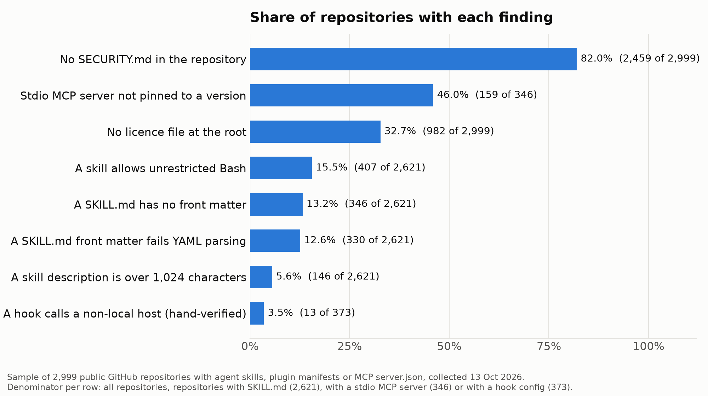
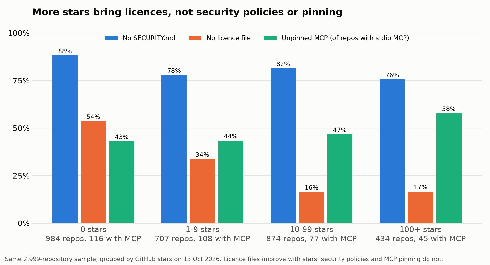
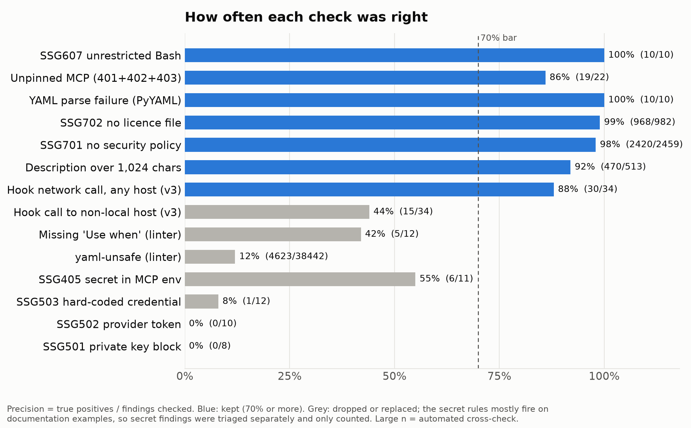

# The state of public agent skills and MCP servers, October 2026

*Muhammad Basit Ali, 13 October 2026. Dataset, method and scripts are in this repository. Data and text: CC BY 4.0. Code: MIT.*

Agent skills, plugin marketplaces and MCP servers are now installed the way browser extensions once were: someone finds a repository, copies a line into a config file and the agent gains new instructions, new shell access or a new process that starts with every session. We wanted to know what that supply looks like on the ground, measured rather than guessed. So we took a random sample of 2,999 public GitHub repositories that ship a `SKILL.md`, a plugin or marketplace manifest, or an MCP `server.json`, scanned them with open-source tools, and hand-checked the scanners before trusting them.

## Key findings

- **No way to report a vulnerability:** 2,459 of 2,999 (82.0%) repositories have no `SECURITY.md`. Among the 434 with 100 or more stars it is still 75.6%.
- **MCP servers that can change under you:** 159 of 346 (46.0%) repositories that configure a local MCP server start at least one with no pinned version; 63 of 346 (18.2%) ask for the `latest` tag outright.
- **No licence:** 982 of 2,999 (32.7%) have no licence file at the root.
- **The whole shell:** 407 of 2,621 (15.5%) repositories with skills give at least one skill unscoped `Bash`, 10,073 declarations in all.
- **Skill headers that do not parse:** in 330 of 2,621 (12.6%) repositories with skills, at least one `SKILL.md` has front matter a standard YAML parser rejects; that is 4,761 of 336,285 (1.4%) files.

Every number in this list is checked against [`data/stats.json`](data/stats.json) in CI by [`scripts/check_numbers.py`](scripts/check_numbers.py).

## Charts

| Finding | Repositories | Denominator | Share |
|---|---|---|---|
| No SECURITY.md in the repository | 2,459 | 2,999 | 82.0% |
| Stdio MCP server not pinned to a version | 159 | 346 | 46.0% |
| No licence file at the root | 982 | 2,999 | 32.7% |
| A skill allows unrestricted Bash | 407 | 2,621 | 15.5% |
| A SKILL.md has no front matter | 346 | 2,621 | 13.2% |
| A SKILL.md front matter fails YAML parsing | 330 | 2,621 | 12.6% |
| A skill description is over 1,024 characters | 146 | 2,621 | 5.6% |
| A hook calls a non-local host (hand-verified) | 13 | 373 | 3.5% |

| Stars | Repositories | No SECURITY.md | No licence file | Repositories with stdio MCP | Unpinned MCP |
|---|---|---|---|---|---|
| 0 | 984 | 88.2% | 53.7% | 116 | 43.1% |
| 1 to 9 | 707 | 77.9% | 33.8% | 108 | 43.5% |
| 10 to 99 | 874 | 81.5% | 16.4% | 77 | 46.8% |
| 100 or more | 434 | 75.6% | 16.6% | 45 | 57.8% |

Licences improve with popularity. Security policies barely move, and pinning does not improve at all; the 100-plus band is the worst for MCP pinning, though on only 45 repositories.

| Check | Findings checked | Correct | Precision | Used? |
|---|---|---|---|---|
| Unrestricted Bash (SSG607) | 10 | 10 | 100% | yes |
| Unpinned MCP (SSG401, 402, 403) | 22 | 19 | 86% | yes |
| Front matter fails YAML parsing | 10 | 10 | 100% | yes |
| No licence file (SSG702), against GitHub | 982 | 968 | 99% | yes |
| No security policy (SSG701), against GitHub | 2,459 | 2,420 | 98% | yes |
| Description over 1,024 characters, against parser | 513 | 470 | 92% | yes |
| Hook makes any network call | 34 | 30 | 88% | yes |
| Hook calls a non-local host | 34 | 15 | 44% | hand-verified count only |
| Linter: no "Use when" sentence | 12 | 5 | 42% | dropped |
| Linter: YAML-unsafe value, against parser | 38,442 | 4,623 | 12% | replaced by parser |
| Literal secret in MCP config (SSG405) | 11 | 6 | 55% | not used for prevalence |
| Hard-coded credential (SSG503) | 12 | 1 | 8% | not used for prevalence |
| Provider token (SSG502) | 10 | 0 | 0% | not used for prevalence |
| Private key block (SSG501) | 8 | 0 | 0% | not used for prevalence |

The chart data is in [`data/chart-data.csv`](data/chart-data.csv) and the full precision table in [`data/precision.csv`](data/precision.csv).

## What we looked at

The repositories came from GitHub code search on 13 October 2026: 93 requests across 31 queries split by file size, which surfaced 7,456 distinct non-fork repositories. We drew 3,000 at random; one failed to download, leaving 2,999. This is a sample of what search surfaces, not a census of GitHub.

The sample is young and mostly small: 2,512 of the 2,999 (84%) were created in 2026, the median repository has 4 stars, and 434 have 100 or more. 2,621 contain at least one skill, 336,285 `SKILL.md` files in all, with a median of 10 per repository. 1,047 ship a plugin manifest, 913 a marketplace manifest, 373 an agent hook configuration and 346 at least one MCP server that runs as a local process.

We fetched only the agent configuration files, ran nothing, and scanned with skill-scan-gate 0.2.0, the description linter, inventory and portability scripts from claude-code-tooling-skills, and mcp-tools-lint 0.2.0, with a standard YAML parser as a reference. [`METHOD.md`](METHOD.md) lists every query, cap, version and precision check.

## The findings in detail

**1. Most repositories give no way to report a vulnerability.** 2,459 of 2,999 (82.0%) have no `SECURITY.md` in the repository; 2,420 (80.7%) have no security policy even counting organisation-wide defaults. Among repositories with 100 or more stars the figure is still 75.6% (of 434).

**2. Nearly half of the MCP configurations run code that can change under you.** Of the 346 repositories that configure a local MCP server, 159 (46.0%) start at least one with no pinned version: 100 (28.9%) run an npm package through `npx` with no exact version, 63 (18.2%) ask for the `latest` tag outright, and 38 (11.0%) run a Python package without a version. Each session start can fetch whatever the package owner, or anyone who takes over the package, published last.

**3. A third ship with no licence.** 982 of 2,999 (32.7%) have no licence file at the root; GitHub's own licence detection finds none for 969. For zero-star repositories it is 53.7% (of 984); for repositories with 100 or more stars, 16.6% (of 434). Without a licence, a team has no clear right to copy a skill into its own repository.

**4. One in six skill repositories gives a skill the whole shell.** 407 of the 2,621 repositories with skills (15.5%) declare at least one skill whose `allowed-tools` grants `Bash` with no command scoping, 10,073 declarations in total. That is not proof of misuse, but it removes the host's chance to ask before each command.

**5. One in eight skill repositories has a skill whose header does not parse.** In 330 of 2,621 (12.6%) at least one `SKILL.md` has YAML front matter that a standard parser rejects, usually because a description contains an unquoted colon. That is 4,761 of 336,285 files (1.4%). A further 346 repositories (13.2%) contain a `SKILL.md` with no front matter at all. A host that cannot read the name and description cannot decide when to load the skill.

Two smaller results. In 146 of 2,621 skill repositories (5.6%) a description runs past 1,024 characters, a common host limit. And of the 373 repositories with hook configurations, 13 (3.5%) have a hook that, by default, calls a host other than the local machine (hand-verified); another 6 talk only to a local service. Across all 2,999, our hook check flagged 34 repositories; reading each one by hand, 30 make a network call of some kind and 15 reach a non-local host by default.

The MCP tool-schema check had little to work with, since a server has to run to list its tools and we ran nothing. In the 10 repositories that commit a tool list (986 tools), all 986 tools lack annotations and 836 declare a JSON Schema dialect that strict clients reject. Those lists are clustered and say little about MCP servers in general.

## Secrets: counted, not named

The secret-shaped-string rules fire in 471 of 2,999 repositories. Read by hand, almost all of those hits are documentation: secret-scanner regexes, placeholder tokens in setup guides, example API responses, deliberately poisoned research corpora. Reporting 471 as "repositories leaking secrets" would be wrong. We triaged every hit by structure, without displaying any value, and were left with 30 possible live credentials in 17 repositories. The totals per rule are in [`data/secret_rules_aggregate.csv`](data/secret_rules_aggregate.csv); the public dataset leaves out per-repository counts for the secret rules (SSG203, SSG405, SSG501, SSG502 and SSG503).

We drop the "missing when-to-use guidance" measure for a similar reason. The linter looks for the literal phrase "Use when", and in a hand check most descriptions it flagged did say when to use the skill, in other words or in another language.

## What this means for teams installing skills

- **Pin every MCP server.** Write `package@1.2.3`, never a bare name or `@latest`, and update on purpose. This is the most common finding that can run code without review, and it is a one-line fix.
- **Read `allowed-tools` before you install.** A skill that asks for unscoped `Bash` should explain why, or be scoped to the commands it needs.
- **Treat hooks as code that runs on every tool call.** Most hooks we read stay local, but some phone home on install or post session data to a webhook. Read the hook scripts, not only the manifest.
- **Check the licence before copying.** One in three repositories in this sample gives you no right to reuse the skill.
- **Lint your own skills in CI.** A colon in a description is enough to stop a host reading the skill header; it is cheap to catch and invisible until it bites.
- **Do not trust a scanner's secret count.** In this corpus most secret-shaped strings were examples. Use the findings as a reading list, then judge them.

## Limitations

- **It does not show harm.** It does not show that any repository is malicious, or that any finding was exploited. It measures the presence of patterns at one commit, on the default branch, without running anything.
- **Sample, not census.** It describes what GitHub code search surfaces, weighted towards young, small, personal projects; a curated marketplace may look better.
- **Static only.** Tool schemas of running MCP servers, hook behaviour at run time and what a skill actually does were not observed.
- **Partial fetch.** Only agent configuration paths were fetched, so a licence or `SECURITY.md` in an unusual place is missed; the GitHub cross-check bounds this at about 1 to 2%.
- **Repository-level counts** treat a mirror of thousands of skills and a single skill the same. File-level counts are given where they matter.
- **Small precision samples.** Some precision samples hold 5 to 12 findings, carry wide uncertainty and say nothing about what the scanners miss.
- **YAML strictness.** "Fails YAML parsing" means one strict parser (PyYAML 6.0.3 `safe_load`) rejects it; an agent host may be more lenient.

## Reproduce it

1. Install the tools: `pip install git+https://github.com/basitalisandhu/skill-scan-gate`, clone `basitalisandhu/claude-code-tooling-skills` and `basitalisandhu/mcp-tools-lint` (`npm ci && npm run build`), and `pip install pyyaml matplotlib`.
2. Search with `scripts/collect.py` (about 15 minutes at the code search rate limit), draw the sample with `scripts/draw_sample.py` and seed 20261013, then run `scripts/meta.py`, `scripts/fetch.py`, `scripts/scan.py` and `scripts/mcplint.py`.
3. Analyse with `scripts/build.py`, `scripts/stats.py` and `scripts/charts.py` to rebuild the dataset, the numbers in this report and the three charts.

Search results change daily, so a rerun draws a different sample; the method, not the exact numbers, is what reproduces. Step-by-step commands are in [`scripts/README.md`](scripts/README.md).

## Repository layout

| Path | Contents |
|---|---|
| `data/dataset.csv`, `data/dataset.json` | One row per repository: repository name, commit, metadata and per-rule counts (secret rules withheld) |
| `data/stats.json` | Every headline number, as computed by `scripts/stats.py` |
| `data/precision.csv` | Hand and automated precision checks for each rule |
| `data/secret_rules_aggregate.csv` | Totals for the secret rules, with no per-repository breakdown |
| `data/chart-data.csv` | The values behind the three charts |
| `charts/` | The three charts as PNG |
| `scripts/` | Collection, fetch, scan and analysis scripts, plus `check_numbers.py` |
| `METHOD.md` | Full method |

## Responsible disclosure

The structural triage left 30 possible live credentials in 17 repositories. These were reported privately to the repository owners before this report was published. No repository with a possible live credential is named here, and the public dataset has no per-repository counts for the secret rules, so it cannot be used to find them. No credential was tried against any service.

## How to cite

Cite the repository with the metadata in [`CITATION.cff`](CITATION.cff) (GitHub shows a "Cite this repository" button), or:

> Ali, M. B. (2026). *The state of public agent skills and MCP servers, October 2026* (Version 1.0.0) [Data set and report]. https://github.com/basitalisandhu/agent-skills-state-2026

## Related tools

- [skill-scan-gate](https://github.com/basitalisandhu/skill-scan-gate): CI gate for skills and plugins (the scanner used here).
- [claude-code-tooling-skills](https://github.com/basitalisandhu/claude-code-tooling-skills): skills to review a third-party skill before installing it and to lint your own descriptions.
- [mcp-tools-lint](https://github.com/basitalisandhu/mcp-tools-lint): lint MCP tool schemas and annotations.
- [agent-off-switch](https://github.com/basitalisandhu/agent-off-switch): find every AI agent identity in Microsoft 365, AWS and GitHub and switch it off.
- [ai-agent-incidents](https://github.com/basitalisandhu/ai-agent-incidents): open dataset of AI agent security incidents.
- Docs hub with every tool and post: https://basitalisandhu.github.io/

## Licence

Data and text (the `data/` and `charts/` folders, this README and `METHOD.md`) are licensed under [CC BY 4.0](LICENSE-DATA). Code (the `scripts/` folder and the CI workflow) is licensed under the [MIT licence](LICENSE).
